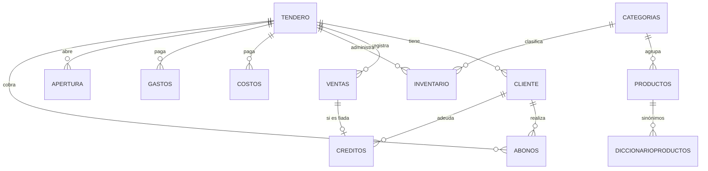

# MiCaja Plus — Backend

API REST y servidor de vistas para **MiCaja Plus**, una aplicación de gestión para tiendas de barrio: ventas, fiados (créditos) y abonos, inventario, costos, gastos y estadísticas del día por tendero.


## Contexto

Muchas tiendas de barrio llevan sus cuentas en cuaderno: se pierden fiados, no saben cuánto ganaron en el día y no controlan el inventario. Este backend resuelve ese flujo de punta a punta: el tendero abre caja, registra ventas (de contado o a crédito), cobra abonos, anota costos y gastos, y consulta su rendimiento por rango de fechas.

El front-end vive en un repositorio/carpeta aparte y consume esta API.

## Funcionalidades

- **Autenticación de tenderos** con hash Argon2id y sesión por cookie (12 h, se renueva con la actividad).
- **Ventas** de contado o a crédito, con precio calculado desde el inventario del tendero.
- **Clientes y fiados:** registro de clientes, saldo pendiente, créditos asociados a ventas y **abonos**.
- **Inventario por tendero** con catálogo global de ~450 productos, categorías y un **diccionario de sinónimos** para reconocer productos escritos de formas distintas (p. ej. "arroz diana" / "diana arroz").
- **Costos** (compras a proveedores), **gastos** y **base de caja** inicial.
- **Estadísticas:** resumen del día, historial de actividades y reporte por rango de fechas.

## Stack

| Capa | Tecnología |
|---|---|
| Lenguaje / framework | Python, Flask 3.1 |
| Base de datos | MySQL 8 (`mysql-connector`, SQL parametrizado, sin ORM) |
| Seguridad | `argon2-cffi`, sesiones firmadas de Flask, CORS restringido (`flask-cors`) |
| Configuración | Variables de entorno (`python-dotenv`) |
| Vistas | Plantillas Jinja2 + JS/CSS estáticos (login y dashboard) |

## Arquitectura

```
app.py                  # Configuración (CORS, sesión) y registro de rutas
conexion.py             # Fábrica de conexiones MySQL (lee variables de entorno)
routes/                 # Capa HTTP: validación de entrada y respuestas JSON
  tenderos.py  sesion.py  clientes.py  operaciones.py
  abonos.py    inventario.py  estadisticas.py
models/                 # Capa de datos: una clase por dominio con el SQL
database/schema.sql     # Esquema MySQL (estructura + categorías base)
templates/  static/     # Login y dashboard
```

Flujo de una petición: `route` valida el JSON → llama al `model` → el modelo ejecuta SQL parametrizado, hace commit y cierra cursor y conexión → la ruta responde con `jsonify` y el código HTTP adecuado.

## Modelo de datos



El esquema completo está en [`database/schema.sql`](database/schema.sql).

## Instalación

Requisitos: Python 3.12+ y MySQL 8.

```bash
git clone <url-del-repositorio>
cd MicajaUltimateBack

python -m venv .venv
source .venv/bin/activate        # Windows: .venv\Scripts\activate
pip install -r requirements.txt

mysql -u <usuario> -p < database/schema.sql

cp .env.example .env             # completar credenciales y SECRET_KEY
python app.py
```

La aplicación queda en `http://localhost:4000` (login en `/inicioSesion`).

### Variables de entorno

| Variable | Descripción | Por defecto |
|---|---|---|
| `DB_HOST`, `DB_PORT` | Servidor MySQL | `localhost`, `3306` |
| `DB_USER`, `DB_PASSWORD`, `DB_NAME` | Credenciales y base de datos | obligatorias |
| `SECRET_KEY` | Clave de firma de sesiones | obligatoria |
| `CORS_ORIGINS` | Orígenes del front, separados por coma | `http://127.0.0.1:5500,http://localhost:5500` |
| `SESSION_COOKIE_SAMESITE`, `SESSION_COOKIE_SECURE` | Atributos de la cookie de sesión | `Lax`, `0` |
| `HOST`, `PORT` | Dirección del servidor de desarrollo | `0.0.0.0`, `4000` |
| `FLASK_DEBUG` | `1` activa el modo debug (solo desarrollo) | `0` |

## Endpoints

Todos devuelven JSON salvo las vistas. Método `POST` con cuerpo JSON salvo indicación.

| Dominio | Endpoints |
|---|---|
| Sesión | `GET /inicioSesion`, `POST /login`, `GET /sesion`, `POST /logout`, `POST /addtendero`, `POST /consultaCedulaTendero` |
| Clientes | `/consultarcliente`, `/buscar_cliente`, `/insertar_cliente`, `/actualizar_cliente`, `/registrar_venta` |
| Operaciones | `/crearventas`, `/registrar_credito`, `/crearcosto`, `/creargasto`, `/agregarBase`, `/cantidadProducto` |
| Abonos | `/abonos` |
| Inventario | `GET /categorias`, `GET /catalogo`, `/operacionesInventario`, `/agregarProducto`, `/editarProducto`, `/sugerirProductos` |
| Estadísticas | `GET /dashboard`, `/consultarEstadisticas`, `/historialActividades`, `/reportePorRango` |

Ejemplo de login:

```http
POST /login
Content-Type: application/json

{ "cedula": "1234567890", "telefono": "3001234567" }
```

```json
{ "cedula": "1234567890", "nombre": "Jandro", "fechaCreacion": "2026-03-25T22:35:42" }
```

La respuesta nunca incluye el hash; la sesión se entrega en una cookie `HttpOnly` con `SameSite=Lax`.

## Seguridad

- Contraseñas (el teléfono del tendero) almacenadas con **Argon2id**.
- Credenciales y `SECRET_KEY` solo por variables de entorno; `.env` está en `.gitignore`.
- Todo el SQL usa parámetros (`%s`), sin concatenar entradas.
- CORS limitado a orígenes configurados; cookie de sesión `HttpOnly` y `SameSite=Lax`.
- Todos los endpoints de datos exigen sesión vigente (401 si no hay o expiró) y el `idTendero` se toma siempre de la sesión, nunca del cuerpo de la petición: un tendero no puede consultar ni modificar datos de otro.
- Modo debug desactivado por defecto.

## Roadmap

- [ ] Limitar intentos de login (rate limiting) y exigir una credencial más robusta que el teléfono.
- [ ] Reemplazar los `print` de depuración por `logging` y no exponer `str(e)` al cliente.
- [ ] Pool de conexiones MySQL.
- [ ] Pruebas automatizadas (pytest) y despliegue con Gunicorn.
- [ ] Documentación OpenAPI.

## Autor

**AFVIVAS** — [github.com/AFVIVAS](https://github.com/AFVIVAS)
